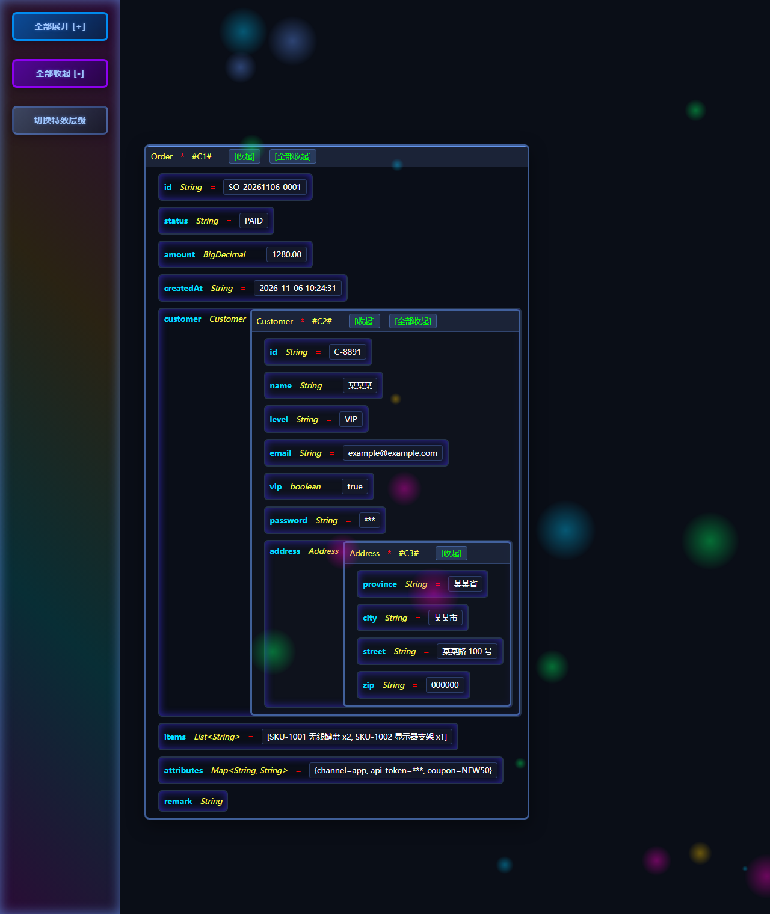
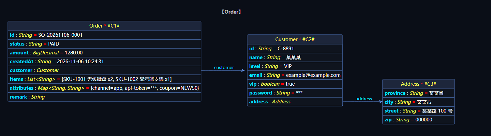
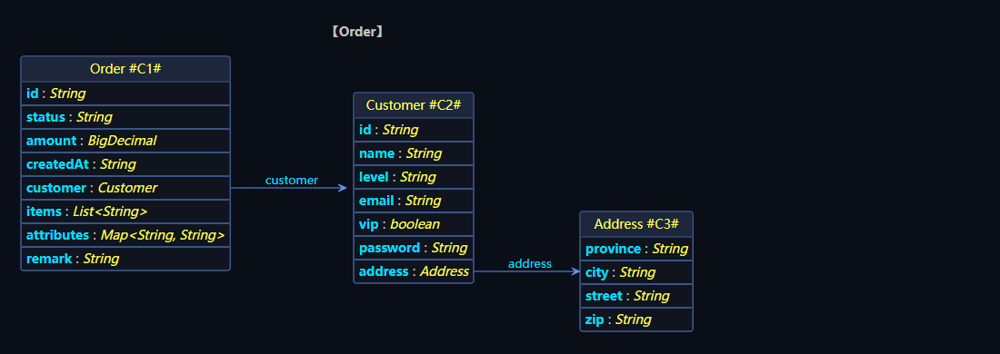

# Lizl Java Data Analyzer

> 把 JVM 里"活的对象"变成可离线查看的结构化报告：字段定义、实例真实取值与引用关系，输出为可折叠 HTML 树或 PlantUML / Mermaid 类图。

它不做诊断——不判断为什么慢、不追查哪里泄漏，只把对象此刻的结构如实读出来、落成文件。

[](https://www.apache.org/licenses/LICENSE-2.0)
[](https://www.oracle.com/java/)
[](https://spring.io/projects/spring-boot)

[Gitee](https://gitee.com/snownnlee/lizl-java-data-analyzer)（主仓）· [GitHub](https://github.com/snownnlee/lizl-java-data-analyzer)（镜像）· Maven 坐标 `io.gitee.snownnlee:lizl-java-data-analyzer`

## 目录

- [它是什么，不是什么](#它是什么不是什么)
- [能力一览](#能力一览)
- [产物示例](#产物示例)
- [快速开始](#快速开始)
- [核心体验：一步观察](#核心体验一步观察)
- [独立 HTTP 服务](#独立-http-服务)
- [Spring Boot 集成](#spring-boot-集成)
- [安全：默认安全，纵深防御](#安全默认安全纵深防御)
- [设计原则](#设计原则)
- [许可证与链接](#许可证与链接)

---

## 它是什么，不是什么

很多工具都要"进场施工"——Arthas 可热修改字节码、MAT 剖析已导出的堆快照、火焰图摊开调用栈。本工具不修改字节码、不 dump 堆，只在被调用时读一遍目标对象的字段。它以一个普通 jar 的形式待在**被观察应用自己的进程里**：不 attach、不连远程 JVM，也不需要在目标机器上另装工具。

|   | 本工具 | Arthas / MAT / VisualVM |
| --- | --- | --- |
| 对现场的影响 | **默认只读**：不开开关不消费一次性容器、不调用有副作用的 `toString`；不装配就不占后台线程 | Arthas 可热修改字节码（只能改方法体）；MAT 只分析离线堆快照，快照得先由 JVM 导出 |
| 观察对象 | 运行进程的活体对象（字段、引用、嵌套结构） | Arthas 同活体；MAT 分析导出的堆快照；VisualVM 实时监控 + 采样/插桩 Profiler，也支持堆快照 |
| 使用门槛 | **把对象放进去即得图**，无需学查询语言 | Arthas 需掌握命令与 OGNL；MAT 需导快照、读引用链；VisualVM 需配 JMX / jstatd 并自己读监控图 |
| 产物形态 | **纯文本图 + HTML**：PlantUML / Mermaid 可进版本库，HTML 可离线折叠浏览 | 终端文本 / 火焰图 / 桌面 GUI，分享要另外导出 |

一句话：**Arthas 是救火，MAT 是法医，本工具是拍照存档**——三者解决不同问题，可互补使用（先用 Arthas 定位到可疑对象，再用本工具把它的结构存档）。

同样明确它不做什么：

- **不做实时监控**：不持续采样 CPU / 内存 / 线程，只在被调用时读一次对象。
- **不做性能分析**：不产出火焰图、不统计方法耗时，这类需求请用 async-profiler / JFR。
- **不留历史**：产物是某一刻的快照，不会自动更新，重算要显式 `?rebuild=true`。

---

## 能力一览

- **结构全、看得清**：同一份产物里既有类字段定义（类型、泛型、静态/final、继承），也有实例真实取值与引用关系；HTML 可折叠交互，`PUML_HTML` / `MERMAID_HTML` 的渲染引擎随产物同目录分发、**不引 CDN**，**断网双击即看**。
- **6 种产物**：`HTML` / `HTML2` / `PUML` / `PUML_HTML` / `MERMAID` / `MERMAID_HTML`。默认 `HTML` 够用；进版本库选纯文本的 `PUML` / `MERMAID`；要双击直接看图选 `PUML_HTML` / `MERMAID_HTML`；对象很大时换 `HTML2`，体积明显更小。
- **接得上、零负担**：纯工具库**运行时零依赖**，Spring 相关依赖均为 `provided + optional`，不传递给使用者；Spring Boot 下三块配置自动装配。
- **查得到**：内置 HTTP 服务，浏览器里点 Bean 名看对象现状。
- **拦得住**：拦截器通道（一组 `/interceptor` 端点）按路径捕获 handler 入参并落盘，可回看线上偶发请求的真实入参。
- **定位得到**：线程名带角色与实例标识（`...-analysis-<容器>`、`...-http-<端口>-N`），thread dump 里能直接对上通道与实例。
- **兜得住、不炸**：深度、节点数默认封顶，另可设耗时上限（默认不限，仅在节点边界做协作式检查）；敏感字段**默认脱敏**为 `***`；分析**默认只读**（不消费一次性容器、不调用有副作用的 `toString`）。

---

## 产物示例

同一份订单数据（嵌套 `Customer` / `Address`、集合、`Map`，含 `password`、`api-token` 等敏感字段）在不同产物形态下的样子，敏感字段脱敏为 `***`：

| 产物与说明 | 预览 |
| --- | --- |
| **`HTML`**：可折叠树，字段定义 + 实例取值 |  |
| **`PUML_HTML`**（按实例分析）：类框内同时给出类型与取值 |  |
| **`PUML_HTML`**（只分析类型）：纯结构类图，不含取值 |  |

---

## 快速开始

一个 jar，不依赖 Spring，JDK 8 及以上即可，Maven / Gradle 都行：

```xml
<dependency>
    <groupId>io.gitee.snownnlee</groupId>
    <artifactId>lizl-java-data-analyzer</artifactId>
    <version>x.x.x</version>
</dependency>
```

```groovy
implementation 'io.gitee.snownnlee:lizl-java-data-analyzer:x.x.x'
```

`x.x.x` 换成最新版本号（[Maven Central 目录](https://repo1.maven.org/maven2/io/gitee/snownnlee/lizl-java-data-analyzer/)）。

下面两节是本库自带的能力：基础用法（出文件）与独立 HTTP 服务（浏览器看图），Spring Boot 项目引入后自动集成，见后文。

---

## 核心体验：一步观察

把「想看的对象」登记进去，立刻得到一张结构图：

```java
import cn.lizl.project.tool.analysis.JavaDataAnalyzer;
import cn.lizl.project.tool.analysis.api.RenderType;

// 1) 全局配置：进程内配一次即可，改完要 apply() 才生效
JavaDataAnalyzer.globalConfigurer()
        .setGlobalOutputRootDir("MyAnalysisHome")   // 产物根目录，相对路径按进程启动目录解析
        .setAnalyzingMaxDepth(10)                   // 最大分析深度，默认 7
        .apply();                                   // 不调 apply() 不会生效

// 2) 一次分析：登记目标 → 选形态 → 执行
JavaDataAnalyzer.runningConfigurer()
        .setOutputFileName("analysis", "订单对象")     // 按路径段拼接：analysis/订单对象.<扩展名>
        .addAnalyzingObject(new Order())              // 实例：类结构 + 真实取值与引用关系
        .addAnalyzingClass(Order.class)               // 只按类型：字段定义（类型/泛型/继承）
        .setRenderType(RenderType.PUML_HTML)          // 6 种产物形态，默认 HTML
        .run();                                       // 默认写文件；取回内容用 runToContent(...)
```

- 产物默认写到 `MyAnalysisHome/analysis/订单对象.html`，扩展名随渲染类型变化。
- HTML 形态默认把样式/脚本放产物同目录，多产物共用一份、浏览器可缓存。
- 要单文件自包含（便于归档，`runToContent(...)` 取回的内容也能直接用）就加 `setInlineAssets(true)`；代价是体积变大，`HTML2` 约 22 KB、`PUML_HTML` 约 5 MB。

---

## 独立 HTTP 服务

想直接在浏览器里点开看？把对象挂上服务（**JDK 原生 `HttpServer`，不依赖 Spring / Servlet / WebFlux**）：

```java
import cn.lizl.project.tool.analysis.http.HttpAnalysisServer;
import cn.lizl.project.tool.analysis.http.SimpleAnalysisProvider;

// 手工登记容器（一组可查看对象）：第一个参数是容器注册名，也是 ?container= 的取值
SimpleAnalysisProvider provider = new SimpleAnalysisProvider("manual",
        JavaDataAnalyzer.runningConfigurer().setOutputRootDir("./analysis"))  // 本次分析的输出根目录
        .add("order", order)   // 名字 + 对象：想观察谁就放谁
        .add(user);            // 不写名字时按类简单名自动生成，重名追加 #2

// 独立服务：预挂 beans 通道，不依赖 Spring
HttpAnalysisServer server = JavaDataAnalyzer.httpServer(provider)
        .setPort(18080)          // 默认 18080；0 表示由系统分配
        .setToken("s3cr3t")      // 绑定回环时可选；绑定非回环地址时必填
        .start();                // 立即开始监听，端口占用等失败抛 IOException
System.out.println(server.getAccessUrl());  // 带 token 的完整地址，浏览器打开即得图
server.stop();                              // 用完关服务，顺带收尾 handler 与 provider 的资源
```

- 对象首次被访问时才分析（懒分析），`?rebuild=true` 强制重算。
- 资源生命周期跟着服务走：`stop()` 按相反顺序回调已挂载的处理器与容器，并关闭重算线程池，不必再手工 `close()`。

**「想观察某个对象时，放进去就能一步实现」**——渲染、命名、产物缓存、HTTP 暴露、鉴权全部由框架接手。

---

## Spring Boot 集成

**它能做什么**：Spring Boot 应用里加依赖、开开关即可，不用手写启动代码。三块能力各自独立：

- **HTTP 服务**（`server.enable`）：起一个只读查看页，浏览器里点 Bean 名看对象现状。
- **Bean 采集**（`beans.enable`）：启动时登记单例，访问 `/bean/{name}` 时才分析（默认懒分析，不访问不落盘）。
  - 默认容器 `SpringBeans`：自动收集应用里所有 Bean。
  - 自定义容器：实现 `AnalysisProvider` 并注册成 Bean 即可，容器名取 `getName()`，访问时用 `?container=` 指定。
- **请求拦截**（`interceptor.enable` + `interceptor.active`）：按路径捕获 handler 入参并落盘，可回看线上偶发请求。

**怎么开启**：四个开关默认全部关闭，不配置就不会产生任何产物与后台线程；`enable` / `enabled` 两种写法都认。三块都打开：

```yaml
cn:
  lizl:
    java-data-analyzer:
      server:
        enable: true          # 起不起 HTTP 服务
      beans:
        enable: true          # 装不装 Bean 通道
      interceptor:
        enable: true          # 装不装拦截器通道
        active: true          # 装好后是否开启捕获（默认 false，可运行期热改）
```

启动后打开 `http://127.0.0.1:18080/lizl-java-data-analyzer/`，索引页只列已启用的通道。常用入口：

| 请求 | 说明 |
| --- | --- |
| `GET /` | 前缀根 `/lizl-java-data-analyzer/` 的通道索引页 |
| `GET /beans` · `POST /beans` | 不带 `container` 时先出容器选择页 / 容器名 JSON；带上后出 Bean 列表页 / Bean 名 JSON |
| `GET /bean/{beanName}` | 指定 Bean 的分析结果，`?rebuild=true` 强制重算 |
| `GET /interceptor` · `.../state` · `.../list` | 拦截器管理页 / 状态 / 产物列表 |
| `GET /interceptor/output/{name}` | 查看某个拦截产物（含页面引用的同目录静态资源） |
| `POST /interceptor?active=` | 运行期热改捕获开关与路径 |

按需调整：

- **鉴权**：配了 `server.token` 时首次访问要带 `?token=xxx`（页面内链接与请求会自动续带），也可改用请求头 `X-Analysis-Token`；配了 `server.auth-user` / `server.auth-password` 时走 HTTP Basic。
- **多容器**（一个容器 = 一组可查看对象的集合，与 Spring 容器无关）：默认容器名 `SpringBeans`，自定义容器取其 `getName()`；例如 `…/beans?container=SpringBeans`、`…/bean/orderController?container=SpringBeans`；`POST /beans` 不带 `container` 时返回容器名列表。
- **路径规则**：`interceptor.include-paths` / `exclude-paths` 用 Ant 风格，按应用内路径匹配（不含 contextPath）。
- **异步分析**：`interceptor.async-analysis` 默认 `false`（请求线程同步分析）；开启后转独立守护线程执行，队列满时回落为请求线程同步执行（不丢产物）。
- **队列容量**：`interceptor.analysis-queue-capacity` 默认 64（MVC）、`interceptor.reactive-analysis-queue-capacity` 默认 256（WebFlux）；小于 1 回落默认并告警，启动期固定。
- **产物资源**：`interceptor.inline-assets` 默认 `false`（样式/脚本/渲染引擎随产物同目录分发、多产物共用一份）；开启后单文件自包含，代价是 `PUML_HTML` 约 5 MB。
- **无需收尾**：`server` Bean 销毁时会按相反顺序停止已挂载的通道与数据容器，不用手写 `close()`。
- **完整模板**：jar 内 `analysis/spring/application-analysis.yaml`，可整段复制。

### 支持矩阵

| 环境 | 纯工具库 / 独立 HTTP 服务 | beans / server 通道 | interceptor（MVC） | WebFlux 捕获 |
| --- | --- | --- | --- | --- |
| Spring Boot 2.7.x（`javax.servlet`） | ✅ | ✅ | ✅ | ✅ |
| Spring Boot 3.x（`jakarta.servlet`） | ✅ | ✅ | ✅ | ✅ |

Spring Boot 3 适配用纯 Spring 抽象（`NativeWebRequest` + `PATH_WITHIN_HANDLER_MAPPING_ATTRIBUTE` + `SCOPE_REQUEST`），不引入 jakarta 编译期依赖，同一份字节码兼容两套宿主。

---

## 安全：默认安全，纵深防御

> 本库会把运行时对象数据**明文导出为报告**，定位是Java应用运行时辅助工具。

- **分析默认只读**：不消费 `Iterator` / `Enumeration` 等一次性容器；不调用有副作用的 `toString`。需开启时显式 `setAnalyzeOneShotCollections(true)` / `setAddToStringField(true)`。
- **敏感值默认脱敏**：按字段名 / Map entry key 匹配 `password`、`token`、`secret`、`authorization` 等子串（**按名匹配的防御默认值，非完备清单**）。
- **绑定非回环地址必须鉴权**：默认绑定 `127.0.0.1` 无鉴权（启动打 WARN）；改成 `0.0.0.0` / 局域网 IP 时**必须**配 `server.token` 或 `server.auth-user` + `server.auth-password`，否则服务拒绝启动。
- **防 DNS rebinding**：单独校验 `Host` 头，不在白名单返回 403；跨代理/局域网用 `server.allowed-hosts` 显式放行。
- **报告是明文文件**：产物明文写入输出目录，无加密、无访问控制，目录权限由操作系统决定；字段值、请求参数、凭证类字段都可能被完整展开。
- **拦截器捕获的是 handler 入参**：登录 DTO、请求头绑定值可能含真实凭证，生产开启前务必用 `include-paths` / `exclude-paths` 圈定路径。
- **token 走 query 会进浏览器历史与访问日志**，条件允许时优先用 `server.auth-user` + `server.auth-password` 的 HTTP Basic；本库日志不输出带 token 的完整地址。写请求的跨站校验不是鉴权替代品。
- **不要在生产常开 HTTP 查看端点，用完即关。**

---

## 设计原则

| 原则 | 体现 |
| --- | --- |
| **安全** | 默认只读、默认脱敏、非回环强鉴权、Host 白名单、常量时间比较 |
| **轻量** | 纯库零运行时依赖；HTTP 服务用 JDK 原生 `HttpServer`；引擎随包分发不引 CDN |
| **方便** | 流式 API 三行出图；`SimpleAnalysisProvider` 一键登记；Spring 下打开 `enable` 即自动装配 |
| **极简** | 新能力默认关闭；能硬编码就不开配置项，确需线上可调才开；能本地脚本就不上平台 |

---

## 许可证与链接

[Apache License 2.0](https://www.apache.org/licenses/LICENSE-2.0)。随包分发的前端引擎为 MIT（来源、版本、许可原文见 jar 内 `analysis/js/SOURCES.txt`）；Spring、Lombok、注解库均不随本库传递。

**snownnlee** · [Gitee Issues](https://gitee.com/snownnlee/lizl-java-data-analyzer/issues) · 欢迎提交 Issue 和 Pull Request。
